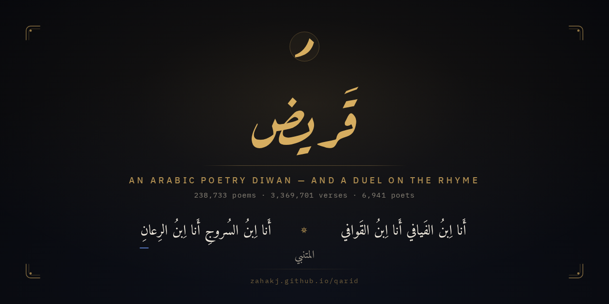
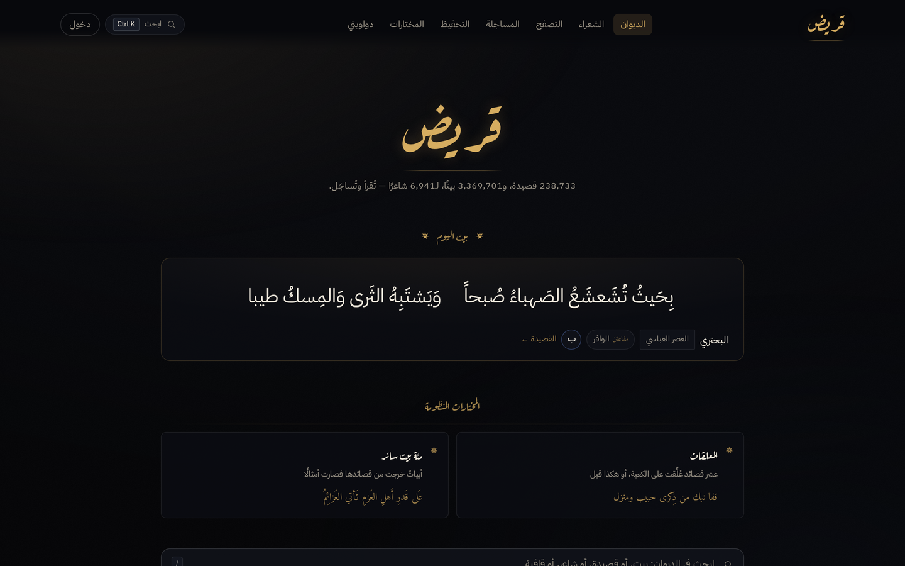

<p align="center"></p>

<div dir="rtl">

# قَريض

ديوانٌ للشعر العربيّ يُتصفَّح ويُبحث فيه، ومساجلةٌ عليه: يُلقى بيتٌ فيُجاب ببيتٍ يبدأ برويّه. على الوِب وأندرويد.

<https://zahakj.github.io/qarid/>

</div>



<div dir="rtl">

## التشغيل

يلزم Node 24 فما فوق، ونحو 2 غ.ب على القرص للمتن.

</div>

```sh
git clone https://github.com/ZahakJ/qarid && cd qarid
npm install
cp .env.example .env          # اضبط PUBLIC_ORIGIN
npm run ingest:fetch          # arbml/ashaar → data/raw/
npm run ingest                # data/qarid.db، نحو 3 دقائق
npm run dev:server & npm run dev   # http://127.0.0.1:5751
```

<div dir="rtl">

بلا متن: `npm run ingest:fixture` يبني عيّنةً صغيرة في `data/fixture.db`.

الإنتاج:

</div>

```sh
npm run build && npm start    # 127.0.0.1:8010 و[::1]:8010
```

<div dir="rtl">

يربط الخادم على loopback وحده؛ ضع أمامه وكيلًا أو نفقًا للـTLS. `deploy/qarid.service` وحدةُ systemd للمستخدم.
أندرويد: [`docs/android.md`](docs/android.md).

## الفحوص

</div>

```sh
npm run typecheck && npm test && npm run build && npm run smoke
```

<div dir="rtl">

## المتن

الأبياتُ من [arbml/ashaar](https://huggingface.co/datasets/arbml/ashaar)، ولا يُعاد نشرُها: `data/` خارج المستودع. التفاصيل في [`docs/internals.md`](docs/internals.md).

## الرخصة

[AGPL-3.0-or-later](LICENSE). الخطوط ([أميري](https://github.com/alif-type/amiri)، [عارف رقعة](https://github.com/aliftype/aref-ruqaa)، IBM Plex) على رخصة OFL.

</div>
