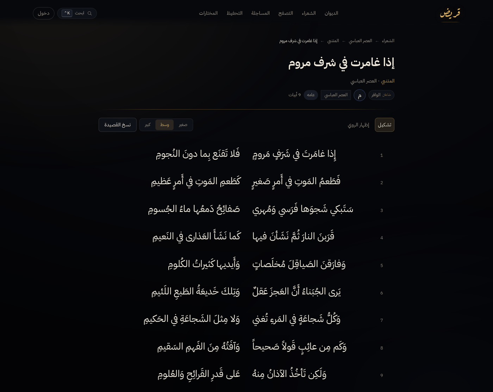
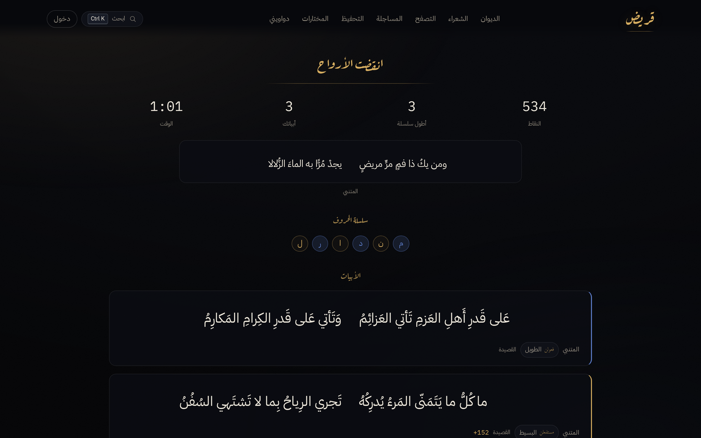
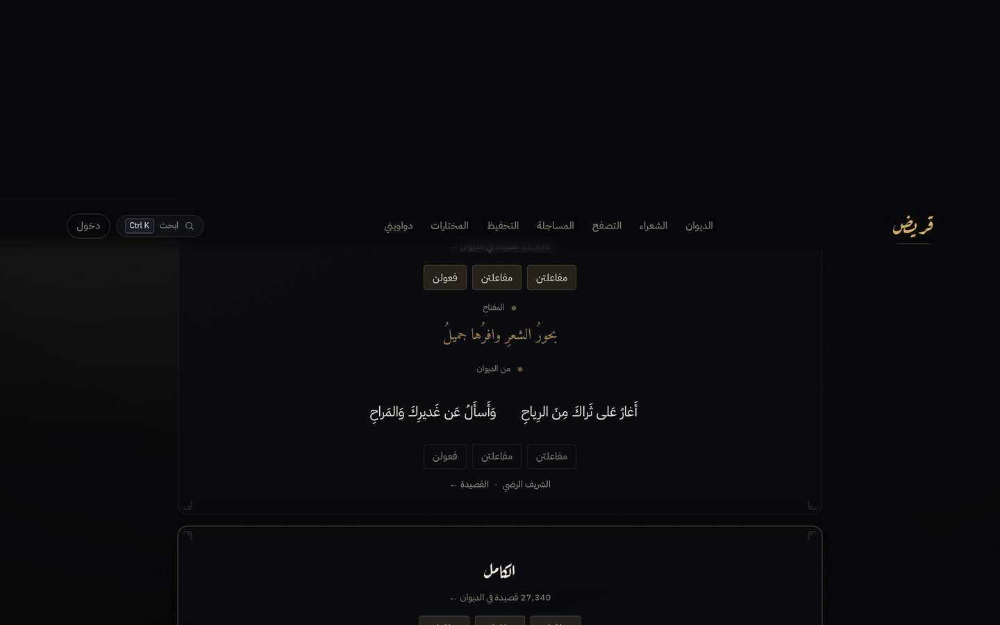
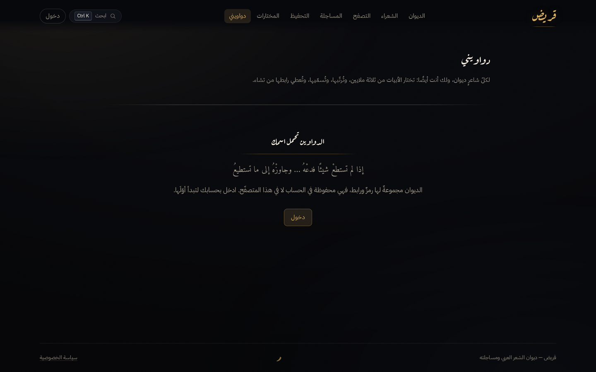

<p align="center"></p>

<div dir="rtl">

# قَريض

قَريض اسمٌ قديمٌ للشعر. وهذا ديوانٌ للشعر العربيّ يُقرأ ويُبحث فيه، ومساجلةٌ تُلعب عليه: يُلقى بيتٌ فيُجاب ببيتٍ يبدأ برويّه. فيه 3,369,701 بيتًا لـ6,941 شاعرًا في 238,733 قصيدة، لقارئ الشعر وحافظه ومَن يكتبه. يعمل على الوِب وعلى أندرويد من مصدرٍ واحد، والواجهةُ كلُّها بالعربيّة.

<https://zahakj.github.io/qarid/>

</div>


| | |
|---|---|
|  |  |
| <div dir="rtl">القصيدة صفحةَ ديوان</div> | <div dir="rtl">مساجلة على الرويّ</div> |
|  |  |
| <div dir="rtl">البحور الستّة عشر، ولكلٍّ شاهد</div> | <div dir="rtl">الدواوين</div> |

<div dir="rtl">

## ما فيه

- **التصفّح والبحث.** بالعصر والبحر والغرض والرويّ، وديوانُ كلِّ شاعر؛ والبحثُ في الأبيات والقصائد والشعراء بتشكيلٍ وبغيره.
- **القراءة.** القصيدةُ صفحةً كما تُطبع، الشطران على الحاشيتين، أو في وضع قراءةٍ تنزوي فيه الأدواتُ كلُّها. التشكيلُ يُظهَر ويُخفى، وثلاثةُ مقاسات، والرويُّ يُخطُّ تحته عند الطلب.
- **المساجلة.** يُلقي الديوانُ بيتًا وتُجيب ببيتٍ يبدأ برويّه، ولا يُقبل إلّا بيتٌ في الديوان. بعدٍّ ووقت، وترسانةٍ من الحروف التي ثبت أنّك تُجيب عليها.
- **مساجلة صديق.** في غرفةٍ برمزٍ من ستّة أحرف ورابطٍ يُرسَل إليه، بحسابٍ أو بلا حساب. الحكمُ والوقتُ عند الخادم، فلا يدّعي أحدُ اللاعبَين بيتًا ليس في الديوان.
- **بيت اليوم.** بيتٌ واحدٌ للناس جميعًا كلَّ يوم، يُشارَك رابطًا وبطاقةً مصوّرة.
- **المختارات والدواوين.** المختاراتُ قائمةٌ على الجهاز بلا حساب. والدواوينُ رفوفٌ مُسمّاةٌ على حساب: تُجمَع وتُرتَّب باليد وتُشارَك، وتُلعب فيها المساجلة.
- **المختارات المنظومة.** رفوفٌ منتقاة، كالمعلّقات العشر ومئة بيتٍ سائر، تُحلُّ على المتن عند التشغيل.
- **التحفيظ.** تمرينٌ على القصيدة حتى تثبت.
- **باحث القافية والبحور.** لمن يكتب: أبياتُ الديوان على رويٍّ تختاره، مضيَّقةً بالبحر والعصر؛ والبحورُ الستّة عشر على دوائر الخليل، لكلِّ بحرٍ تفعيلاتُه ومفتاحُه وشاهدٌ مشكول.

## التشغيل

يلزم Node 24 فما فوق، ونحو 2 غ.ب على القرص للمتن.

</div>

```sh
git clone https://github.com/ZahakJ/qarid && cd qarid
npm install
cp .env.example .env          # اضبط PUBLIC_ORIGIN
npm run ingest:fetch          # arbml/ashaar → data/raw/
npm run ingest                # data/qarid.db، نحو 3 دقائق
npm run dev:server & npm run dev   # http://127.0.0.1:5751
```

<div dir="rtl">

بلا متن: `npm run ingest:fixture` يبني عيّنةً صغيرة في `data/fixture.db`.

الإنتاج:

</div>

```sh
npm run build && npm start    # 127.0.0.1:8010 و[::1]:8010
```

<div dir="rtl">

يربط الخادم على loopback وحده؛ ضع أمامه وكيلًا أو نفقًا للـTLS. `deploy/qarid.service` وحدةُ systemd للمستخدم. المتغيّراتُ كلُّها مشروحةٌ في `.env.example`: قاعدة الحسابات، والتسجيل بدعوة، وحسابات الإشراف.
أندرويد: [`docs/android.md`](docs/android.md).

## كيف يعمل

يقرأ `scripts/ingest/` ملفّاتِ المتن ويكتبها مِعلَمًا واحدًا من SQLite، فيه الأبيات مطبَّعةً ومفهرسةً بـFTS5، وتجزئةٌ لكلِّ بيتٍ ولكلِّ صدر، وعددُ ما يُلعب من الأبيات على كلِّ حرف. ويُفتح هذا المِعلَم للقراءة وحدها في الخادم (Hono على `node:sqlite`)؛ وما يُكتب من الحسابات والغرف في ملفٍّ آخر. والتطبيعُ في ملفٍّ واحد، `shared/arabic.ts`، يستورده الاستيعابُ والخادم كلاهما، فما يكتبه المرءُ في المساجلة يُطبَّع كما طُبِّع المتن. ولذلك يجري الحكمُ على الجواب درجات: الحرفُ الأوّل أوّلًا، ثمّ تطابقُ تجزئة البيت كلِّه أو صدره، ثمّ بحثٌ تقريبيّ بـFTS5 يُقبل فيه البيتُ إذا شابه ما كُتب شبهًا كافيًا، فإن التبس بين قصيدتين سُئل اللاعبُ أيّهما أراد. والواجهةُ React، ونسخةُ أندرويد غلافٌ من Capacitor حولها يتّصل بنشرٍ يُسمّى عند البناء.

## الفحوص

</div>

```sh
npm run typecheck && npm test && npm run build && npm run smoke
```

<div dir="rtl">

`npm run smoke` يشغّل الخادم الحقيقيّ ويمرّ على الصفحات في Chromium بلا واجهة، ويفشل عند أيّ خطأ في الطرفيّة؛ و`npm run smoke -- --mobile` يمرّ عليها بمقاس الهاتف.

## الوثائق

- [`docs/internals.md`](docs/internals.md): البنية، والمسارات، والثوابت، وقياسات المتن.
- [`docs/design-server.md`](docs/design-server.md) و[`docs/design-ux.md`](docs/design-ux.md): تصميم الخادم والواجهة.
- [`docs/online-match.md`](docs/online-match.md): المساجلة بلا حساب.
- [`docs/android.md`](docs/android.md): بناء نسخة أندرويد.

## المتن

الأبياتُ من [arbml/ashaar](https://huggingface.co/datasets/arbml/ashaar)، ولا يُعاد نشرُها: `data/` خارج المستودع. التفاصيل في [`docs/internals.md`](docs/internals.md).

## الرخصة

[AGPL-3.0-or-later](LICENSE). الخطوط ([أميري](https://github.com/alif-type/amiri)، [عارف رقعة](https://github.com/aliftype/aref-ruqaa)، IBM Plex) على رخصة OFL.

</div>
